# 🏗️ Awesome Monorepo & Build Systems

<p align="center">
  
</p>

<p align="center">
  <a href="https://github.com/ishandutta2007/Awesome-Awesome-Awesome"></a>
  <a href="https://discord.gg/jc4xtF58Ve"></a>
  <a href="https://github.com/ishandutta2007/Awesome-Monorepo-Build-Systems/stargazers"></a>
  <a href="https://github.com/ishandutta2007/Awesome-Monorepo-Build-Systems/network/members"></a>
  <a href="LICENSE"></a>
  <a href="https://github.com/ishandutta2007/Awesome-Monorepo-Build-Systems/pulls"></a>
  <a href="https://github.com/ishandutta2007"></a>
</p>

---

## ⚡ Top Monorepo & Build Systems Ecosystem Guide

> **A rigorously curated directory of SaaS platforms, enterprise build orchestrators, and open-source monorepo tools.**  
> *Engineered for platform architects, DevOps leaders, and software engineers scaling multi-package repositories, distributed remote caching, action-graph orchestration, and hermetic reproducibility.*

Modern software engineering teams face escalating complexity as applications expand across shared codebases. Monorepo build systems solve this by computing exact directed acyclic dependency graphs (DAGs), executing only affected tasks, deduplicating artifact compilation through remote build caching, and enforcing strict hermetic boundaries so build outputs remain 100% reproducible across local machines and continuous integration (CI) pipelines.

---

## 📑 Table of Contents

- [📊 Sector Overview & Market Dynamics](#-sector-overview--market-dynamics)
- [☁️ SaaS & Hosted Acceleration Platforms](#️-saas--hosted-acceleration-platforms)
- [🔓 Open-Source Build Systems & Task Orchestrators](#-open-source-build-systems--task-orchestrators)
- [🧩 Architectural Comparison Matrix](#-architectural-comparison-matrix)
- [🧭 Decision Matrix: Choosing the Right Tool](#-decision-matrix-choosing-the-right-tool)
- [🤝 How to Contribute](#-how-to-contribute)
- [💖 Support](#-support)
- [⚠️ Disclaimer](#️-disclaimer)
- [📈 Star History](#-star-history)

---

## 📊 Sector Overview & Market Dynamics

The global **Build Automation and Developer Productivity Engineering (DPE)** market is valued between **$8.6 Billion and $12.5 Billion**, projected to expand at a compound annual growth rate (**CAGR**) of **16.2%** to exceed **$22 Billion by 2032**. This rapid acceleration is propelled by developer infrastructure costs, distributed multi-repo exhaustion, and the enterprise adoption of cloud-native remote execution backends.

Rather than consolidating into a singular "winner-take-all" monopoly, the market is **moderately fragmented and ecosystem-segmented**. Tool selection is strongly anchored in programming language affinity and enterprise scale:
- **JavaScript & TypeScript ecosystems** are heavily influenced by **Vercel (Turborepo)** and **Nrwl (Nx)**.
- **Enterprise JVM environments** standardize on **Gradle Inc. (Develocity)**.
- **Massive polyglot enterprises** (spanning C++, Java, Go, Python, and Rust) standardize on Google Blaze-descended action-graph systems like **Bazel** and Meta's **Buck2**, supported by independent Remote Execution API (REAPI) providers such as **BuildBuddy**, **EngFlow**, and **NativeLink**.

---

## ☁️ SaaS & Hosted Acceleration Platforms

The table below ranks commercial SaaS platforms by enterprise company size (valuation / ARR descending), featuring verified starting prices and precise free tier allowances.

| 🏢 Platform / Vendor | 💰 Company Size (Valuation / Revenue) | 🏷️ Starting Paid Pricing | 🎁 Free Tier Limits & Trial Policy | 🚀 Core Capabilities & Architecture |
| :--- | :--- | :--- | :--- | :--- |
| **[Vercel Remote Cache](https://vercel.com/docs/monorepos/remote-caching)** | **$3.25 Billion** *(Valuation, Series E; $150M+ ARR)* | **$20 / seat / month** *(Pro Plan; includes $20/mo platform usage credits)* | **Free forever (Hobby Plan)**: Strictly personal use; 1 seat; includes 100 GB/month remote cache upload bandwidth and 100 requests/minute fair-use limit. | Turnkey managed cache for Turborepo and Nx. Zero-config integration via two environment variables (`TURBO_TOKEN`, `TURBO_TEAM`) with instant artifact sharing across local terminals and Vercel CI. |
| **[Docker Build Cloud](https://www.docker.com/products/build-cloud/)** | **$2.10 Billion** *(Valuation; $130M+ ARR)* | **$7 / user / month** *(Team Plan)* or **$5 / builder / month** *(Standalone Starter)* | **Free forever (Personal Plan)**: 100 Build Cloud build minutes per month, 8 parallel build threads, and shared team container layer cache. | High-concurrency cloud container build cache. Delivers native multi-architecture compilation (AMD64 & ARM64) simultaneously without CPU emulation overhead. |
| **[Develocity](https://develocity.ai/)** *(formerly Gradle Enterprise)* | **~$500 Million** *(Valuation; $156M+ funding; ~$50M ARR)* | **$47,940 / year base benchmark** *(scales to ~$25–$35 / dev / month on enterprise annual contract)* | **Free forever Public Build Scans** (at `scans.gradle.com` with 0 private cache storage) + **30-day Proof-of-Concept (PoC) enterprise trial** with full remote caching, test distribution, and predictive test selection. | Comprehensive observability and acceleration suite for Gradle, Maven, Bazel, Android, and sbt. Features cross-team cache diagnostics, flaky-test suppression, and predictive test running. |
| **[Nx Cloud](https://nx.app/)** *(by Nrwl)* | **~$180 Million** *(Est. Valuation; $30M+ ARR)* | **$29 / month base platform fee + $19 / contributor / month** *(Team Plan; extra credits at $5.50 / 10k credits)* | **Free forever (Hobby Plan)**: 50,000 credits/month, up to 5 complimentary contributors, 10 concurrent CI connections, and full remote caching. | Dedicated distributed task execution layer for Nx. Provides dynamic action splitting across Nx Agents, pipeline heatmaps, module boundary enforcement, and execution graphs. |
| **[BuildBuddy Cloud](https://www.buildbuddy.io/)** | **~$80 Million** *(Est. Valuation; $16.7M Series A)* | **$50 / month base Team plan** *(includes base usage; $15 / seat / month for additional members)* | **Free forever (Personal Plan)**: Up to 3 team members, unlimited cache storage for public open-source repos, and 2 hours/month of Remote Build Execution (RBE). | REAPI-compliant build acceleration platform for Bazel. Combines shared distributed caching, remote dockerized execution clusters, and real-time Build Event Protocol (BES) dashboards. |
| **[EngFlow](https://www.engflow.com/)** | **~$60 Million** *(Est. Valuation; $22M Series A)* | **$1,500 / month** *(Managed Cloud Starter, up to 50 cores)* or custom annual enterprise licensing | **30-day guided Proof-of-Concept (PoC) trial**: Up to 25 dedicated execution cores with full Bazel/REAPI cache integration and setup engineering support. | Enterprise-grade remote execution and caching engine for Bazel, Buck2, and Chromium builds. Created by the core engineers behind Google Blaze and Bazel; deployable in AWS, GCP, and Azure VPCs. |

---

## 🔓 Open-Source Build Systems & Task Orchestrators

Below are the leading open-source monorepo tools, task orchestrators, and caching engines, **ranked strictly by GitHub stargazers count (descending)**.

### 1. [pnpm Workspaces](https://github.com/pnpm/pnpm) [](https://github.com/pnpm/pnpm/stargazers)
- **Ecosystem**: Node.js / JavaScript / TypeScript
- **License**: MIT
- **Primary Strength**: Fast, disk space efficient package manager and monorepo workspace foundation.
- **Architecture**: Employs a content-addressable hard-link store to eliminate duplicate dependencies across packages. Its native `pnpm-workspace.yaml` engine provides topological dependency graph sorting, recursive script execution (`pnpm --filter`), and strict dependency isolation that prevents phantom dependency imports. Serves as the package resolution foundation for modern Lerna, Turborepo, and Rush.

### 2. [Lerna](https://github.com/lerna/lerna) [](https://github.com/lerna/lerna/stargazers)
- **Ecosystem**: JavaScript / TypeScript / Node.js
- **License**: MIT
- **Primary Strength**: Automated versioning, package changelog generation, and multi-package publishing to npm registries.
- **Architecture**: Historically the pioneer of JavaScript monorepos (used by React, Babel, and Jest). In modern versions (v7+ managed alongside Nrwl), legacy linking was replaced by native package manager workspaces. Lerna now focuses on battle-tested version bumping, git tag synchronizations, independent or fixed semantic release pipelines, and optional Nx task scheduling integration.

### 3. [Turborepo](https://github.com/vercel/turborepo) [](https://github.com/vercel/turborepo/stargazers)
- **Ecosystem**: JavaScript / TypeScript / Polyglot Web
- **License**: MIT
- **Primary Strength**: Incremental computation task runner written in Rust with minimal onboarding friction.
- **Architecture**: Designed to drop into any existing pnpm, npm, or Yarn workspace in minutes without rewriting project configs. Developers configure pipelines via `turbo.json`, defining task inputs, outputs, and dependencies. Turborepo fingerprints environment variables, source files, and command arguments to run only affected tasks (`--filter`), multiplexing output logs and streaming cache artifacts to Vercel Remote Cache or custom HTTP endpoints.

### 4. [Nx](https://github.com/nrwl/nx) [](https://github.com/nrwl/nx/stargazers)
- **Ecosystem**: TypeScript / JavaScript / Go / Python / Java / .NET
- **License**: MIT
- **Primary Strength**: Enterprise-scale monorepo platform with AST-aware code generators and architectural boundaries.
- **Architecture**: Features a Rust-powered project graph analysis engine that maps relationships between libraries and applications. Offers deep architectural governance via ESLint boundary rules (e.g., preventing feature modules from importing domain internals), interactive project dependency graphs, automated code migrations, and distributed task orchestration via Nx Cloud.

### 5. [Bazel](https://github.com/bazelbuild/bazel) [](https://github.com/bazelbuild/bazel/stargazers)
- **Ecosystem**: Polyglot (C++, Java, Go, Rust, Python, Android, iOS, WebAssembly)
- **License**: Apache-2.0
- **Primary Strength**: The industry reference standard for massive multi-language enterprise monorepos.
- **Architecture**: Derived from Google's internal Blaze system. Bazel models software construction as a pure, deterministic action graph declared via Starlark (a Python dialect). Enforces strict hermetic sandboxing where actions access exclusively declared inputs. Utilizes the Remote Execution API (REAPI) standard, enabling distributed caching and remote worker fleet compilation across thousands of parallel nodes.

### 6. [Gradle](https://github.com/gradle/gradle) [](https://github.com/gradle/gradle/stargazers)
- **Ecosystem**: JVM (Java, Kotlin, Scala, Groovy), Android, C/C++
- **License**: Apache-2.0
- **Primary Strength**: Highly customizable, incremental build automation engine for enterprise JVM applications.
- **Architecture**: Combines declarative build logic with programmatic Groovy/Kotlin DSLs. Features continuous task caching, compilation daemon reuse, configuration caching to avoid recalculating project models, and deep integration with Develocity for distributed build cache acceleration and analytical build scans.

### 7. [Earthly](https://github.com/earthly/earthly) [](https://github.com/earthly/earthly/stargazers)
- **Ecosystem**: Polyglot / Container-Centric (Any language that runs in Docker)
- **License**: Business Source License 1.1 / Apache-2.0
- **Primary Strength**: Container-isolated build automation with Dockerfile-familiar syntax (`Earthfile`).
- **Architecture**: Synthesizes the declarative ergonomics of Dockerfiles with the dependency-directed caching of Make. Every target executes inside an isolated BuildKit container sandbox, guaranteeing identical build outputs locally and on any CI server. Features automatic parallel layer caching and multi-platform compilation targets.

### 8. [Rush](https://github.com/microsoft/rushstack) [](https://github.com/microsoft/rushstack/stargazers)
- **Ecosystem**: JavaScript / TypeScript / Node.js
- **License**: MIT
- **Primary Strength**: Microsoft's enterprise governance orchestrator for high-headcount engineering organizations.
- **Architecture**: Built specifically to manage massive teams working in a single Git repository (powering the Azure SDK and Office 365 web apps). Implements strict dependency approval workflows, deterministic package manager installation guards, phased builds for granular parallelization, and enforced change-description tracking for semantic version bump safety.

### 9. [Tuist](https://github.com/tuist/tuist) [](https://github.com/tuist/tuist/stargazers)
- **Ecosystem**: Swift / Objective-C / Apple Platforms (iOS, macOS, visionOS, watchOS, tvOS)
- **License**: MIT
- **Primary Strength**: Xcode project generation, modular architecture management, and binary caching.
- **Architecture**: Eliminates git conflicts in `.xcodeproj` and `.xcworkspace` files by generating project structures on demand from Swift configuration manifests (`Project.swift`). Accelerates large iOS monorepos by dynamically replacing unchanged source targets with pre-compiled binary xcframeworks from cloud or local caches.

### 10. [Buck2](https://github.com/facebook/buck2) [](https://github.com/facebook/buck2/stargazers)
- **Ecosystem**: Polyglot (Rust, C++, Python, Java, Go, Erlang, OCaml)
- **License**: Apache-2.0
- **Primary Strength**: Meta's next-generation, high-performance polyglot build orchestrator written in Rust.
- **Architecture**: Re-architected from the ground up to address original Buck limitations. Features Starlark-based configuration, first-class virtual inputs, unified single-daemon architecture, and native REAPI remote execution support. Separates the rule execution engine from build concepts, delivering blazing analysis speed and high concurrency.

### 11. [Moon](https://github.com/moonrepo/moon) [](https://github.com/moonrepo/moon/stargazers)
- **Ecosystem**: Polyglot Web (JavaScript, TypeScript, Rust, Go, Python, Ruby, PHP)
- **License**: MIT
- **Primary Strength**: Rust-powered repository management toolchain and workspace orchestrator.
- **Architecture**: Utilizes a centralized `.moon/` workspace topology with declarative `moon.yml` task definitions. Manages programming language runtimes automatically via integrated toolchains (Proto), calculates task dependency hashes, isolates test executions, and caches build outputs across developers.

### 12. [Pants](https://github.com/pantsbuild/pants) [](https://github.com/pantsbuild/pants/stargazers)
- **Ecosystem**: Python-First Polyglot (Python, Go, Java, Scala, Kotlin, Shell, Docker)
- **License**: Apache-2.0
- **Primary Strength**: Automatic dependency inference and hermetic resolve management for Python & polyglot monorepos.
- **Architecture**: Re-engineered with a Rust core engine orchestrating an asynchronous Python-driven plugin system. Uniquely parses source code imports to infer the dependency graph automatically, minimizing manual `BUILD` file maintenance. Supports isolated multi-python interpreter resolves, per-resolve lockfiles, fine-grained test concurrency, and remote execution.

### 13. [Mill](https://github.com/com-lihaoyi/mill) [](https://github.com/com-lihaoyi/mill/stargazers)
- **Ecosystem**: JVM (Scala, Java, Kotlin)
- **License**: MIT
- **Primary Strength**: High-performance, deterministic alternative to sbt and Maven for JVM codebases.
- **Architecture**: Uses strongly-typed Scala DSL for build definitions. Implements an explicit action graph where targets are pure functions with cached filesystem outputs. Delivers millisecond-level incremental builds, native parallel task execution, and clear module inheritance hierarchies without build complexity bloat.

### 14. [Please](https://github.com/thought-machine/please) [](https://github.com/thought-machine/please/stargazers)
- **Ecosystem**: Polyglot (Go, C++, Java, Python, TypeScript)
- **License**: Apache-2.0
- **Primary Strength**: Fast, developer-friendly cross-language build system with minimal dependencies.
- **Architecture**: Written in Go with Starlark build syntax. Designed to offer Bazel-style reproducibility and hermetic guarantees with lower administrative overhead. Includes native cross-compilation, REAPI distributed cache compatibility, built-in test containerization, and interactive terminal dashboard progress.

### 15. [NativeLink](https://github.com/TraceMachina/nativelink) [](https://github.com/TraceMachina/nativelink/stargazers)
- **Ecosystem**: Infrastructure Backend (Compatible with Bazel, Buck2, Pants, Reclient)
- **License**: Apache-2.0
- **Primary Strength**: Ultra-fast, open-source REAPI remote execution engine and distributed CAS/AC build cache written in Rust.
- **Architecture**: Engineered for hyper-scale compilation workloads (trusted by Samsung and leading infrastructure teams). Delivers microsecond-level Content Addressable Storage (CAS) operations, zero-copy I/O architectures, S3/NVMe tiered caching, and scalable worker scheduling across on-prem or cloud Kubernetes clusters.

### 16. [Melos](https://github.com/invertase/melos) [](https://github.com/invertase/melos/stargazers)
- **Ecosystem**: Dart & Flutter
- **License**: Apache-2.0
- **Primary Strength**: Multi-package monorepo management for Dart libraries and Flutter applications.
- **Architecture**: Integrates with `pubspec.yaml` workspaces. Coordinates local dependency linking, automated semantic versioning, conventional commit changelog generation, and filtered script execution across hundreds of packages (widely used in FlutterFire and the Flutter ecosystem).

### 17. [Lage](https://github.com/microsoft/lage) [](https://github.com/microsoft/lage/stargazers)
- **Ecosystem**: JavaScript / TypeScript / Node.js
- **License**: MIT
- **Primary Strength**: Minimalist task runner for JavaScript monorepos with pipeline caching.
- **Architecture**: Created by Microsoft as a lightweight, focused task scheduler. Maps package task dependencies (e.g., `build` depends on upstream dependencies' `build`, while `test` depends on local `build`), executing actions concurrently with hashing and remote cache plugins.

### 18. [BuildBuddy (OSS Core)](https://github.com/buildbuddy-io/buildbuddy) [](https://github.com/buildbuddy-io/buildbuddy/stargazers)
- **Ecosystem**: Infrastructure / Bazel Ecosystem (Go, React)
- **License**: MIT / Enterprise
- **Primary Strength**: Open-source remote build execution (RBE), caching server, and web UI for Bazel.
- **Architecture**: Provides a self-hostable implementation of the Remote Execution API. Ingests Build Event Streams (BES), visualizes test runs and build metrics, and manages worker nodes executing hermetic Docker container actions for Bazel workflows.

### 19. [bazel-remote](https://github.com/buchgr/bazel-remote) [](https://github.com/buchgr/bazel-remote/stargazers)
- **Ecosystem**: Infrastructure / Bazel & REAPI Clients
- **License**: Apache-2.0
- **Primary Strength**: Lightweight, production-proven remote HTTP/1.1 and gRPC cache for Bazel.
- **Architecture**: Written in Go. Acts as an in-memory or disk-backed Content Addressable Storage (CAS) and Action Cache (AC) proxy. Supports optional S3, Google Cloud Storage, or Azure Blob backend persistence with automatic LRU cache eviction and zero external database requirements.

---

## 🧩 Architectural Comparison Matrix

| Tool | Primary Languages | Configuration DSL | Action Graph Model | Remote Cache Protocol | Hermetic Execution Sandbox | Code Generation / Scaffolding |
| :--- | :--- | :--- | :--- | :--- | :--- | :--- |
| **Turborepo** | JS, TS, Polyglot | `turbo.json` | Task-level | HTTP / S3 / Vercel API | Process level (Env scoping) | Template-based (`turbo gen`) |
| **Nx** | TS, JS, Polyglot | `nx.json` / Project JSON | Task & Project level | REST / Nx Cloud Protocol | Process level (Module boundary lint) | Full AST Generators |
| **Bazel** | Polyglot (Any) | Starlark (`BUILD.bazel`) | Fine-grained Action Graph | REAPI (gRPC / CAS / AC) | Strict OS Sandboxing (Namespaces) | Starlark Rule generation |
| **Buck2** | Polyglot (Any) | Starlark (`BUCK`) | Fine-grained Action Graph | REAPI (gRPC) | Native Sandboxing | Starlark Rules |
| **Pants** | Python, Polyglot | Pythonic Starlark (`BUILD`)| Fine-grained Action Graph | REAPI (gRPC) | Isolated chroots / Docker | Auto Dependency Inference |
| **Rush** | JS, TS | `rush.json` | Phased Task Graph | Custom / Cloud Storage | Symlink isolation | Template-based |
| **Gradle** | JVM (Java, Kotlin) | Kotlin / Groovy DSL | Task & Transform Graph | Develocity Protocol / HTTP | Gradle Worker API | Plugin-driven |
| **Earthly** | Polyglot / Containers | `Earthfile` | Docker Layer Directed Graph | BuildKit Cache / Cloud | Full Container Isolation | Dockerfile base layers |
| **Tuist** | Swift, Xcode | `Project.swift` | Target Graph | HTTP / Tuist Cloud | Process level / xcframeworks | Project generation DSL |
| **Moon** | Polyglot Web | `moon.yml` | Task & Project Graph | HTTP / Moonbase | Process level | Template code gen |

---

## 🧭 Decision Matrix: Choosing the Right Tool

```
                        What is your primary codebase composition?
                                        │
           ┌────────────────────────────┼────────────────────────────┐
           ▼                            ▼                            ▼
   Pure JavaScript / TS           Polyglot / Multi-Lang         Pure JVM / Apple
           │                            │                            │
 ┌─────────┴─────────┐        ┌─────────┴─────────┐        ┌─────────┴─────────┐
 ▼                   ▼        ▼                   ▼        ▼                   ▼
Small to Mid       Enterprise Huge scale?       Python      JVM: Gradle/Mill   iOS: Tuist
Fast Setup         Governance Hermeticity?      Heavy?
Turborepo          Nx / Rush  Bazel / Buck2     Pants
```

1. **Choose [Turborepo](https://github.com/vercel/turborepo)** if you have a JavaScript or TypeScript codebase, already use pnpm or Yarn workspaces, and desire fast setup with zero configuration overhead and turnkey Vercel cloud caching.
2. **Choose [Nx](https://github.com/nrwl/nx)** if you manage large JavaScript/TypeScript or hybrid monorepos requiring strict architectural boundaries, code scaffolding generators, and distributed task workers.
3. **Choose [Bazel](https://github.com/bazelbuild/bazel) or [Buck2](https://github.com/facebook/buck2)** if you operate a large polyglot enterprise repository (C++, Java, Go, Rust, Python) where deterministic hermeticity, sub-second action-level caching, and REAPI remote execution are essential.
4. **Choose [Pants](https://github.com/pantsbuild/pants)** if your codebase is heavily Python-centric (data engineering, machine learning services) and you require automated dependency inference without maintaining laborious BUILD file manifests.
5. **Choose [Gradle](https://github.com/gradle/gradle) / [Develocity](https://develocity.ai/)** if your applications live in the JVM ecosystem (Java, Kotlin, Scala, Android) and require deep compiler daemon reuse and enterprise test intelligence.
6. **Choose [Tuist](https://github.com/tuist/tuist)** if you manage large iOS/macOS codebases and suffer from slow Xcode compilation times and git project merge conflicts.
7. **Pair with [NativeLink](https://github.com/TraceMachina/nativelink) or [BuildBuddy](https://github.com/buildbuddy-io/buildbuddy)** if you run Bazel/Buck2/Pants and require a high-throughput, self-hosted remote execution and caching cluster.

---

## 🤝 How to Contribute

We welcome community contributions, architectural insights, and additions of emerging build tools!

1. **Fork the Repository**: Click `Fork` on GitHub.
2. **Create a Feature Branch**: `git checkout -b feature/add-new-build-tool`
3. **Format Your Entry**:
   - Provide the tool name, official link, license, and primary capabilities.
   - For SaaS tools: Include verified company size, specific starting price, and exact free tier allowances.
   - For open-source tools: Include social style Stars_Badge (`style=social&color=white`) linking to `/stargazers`.
4. **Submit a Pull Request**: Provide a clear rationale and references in your PR description.

---

## 💖 Support

If you found this ecosystem compilation helpful for architecting your monorepo infrastructure:
- ⭐ **Star this repository** to support discoverability!
- 🍴 **Fork it** to share with your platform and DevOps engineering teams.
- ☕ **Sponsor the Maintainer**: Support ongoing open-source research and directory curation on the [GitHub Sponsors Dashboard](https://github.com/sponsors/ishandutta2007).

---

## ⚠️ Disclaimer

- This directory is an independent, community-curated ecosystem index. Project names, logos, and trademarks belong to their respective copyright holders.
- Build system selection involves fundamental architectural trade-offs: action-graph systems (Bazel/Buck2) provide ironclad reproducibility at the expense of a steeper learning curve and dedicated maintenance teams; lightweight runners (Turborepo/Nx) provide rapid developer velocity with lower administrative overhead. Benchmark tools against your team's specific language distribution and build graph complexity.

---

## 📈 Star History

[](https://star-history.dera.page/#ishandutta2007/Awesome-Monorepo-Build-Systems&type=date&legend=top-left)

---

<p align="center">
  <sub>Maintained with ❤️ for platform engineers, infrastructure architects, and developer experience (DevEx) teams worldwide.</sub>
</p>
